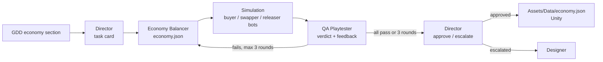

# Good Enough Repairs

A 2D management / repair puzzle game made in **Unity 6 (URP 2D)**. You are the space mechanic who keeps fighters and freighters flying. Ships dock with weak parts, and the winning move is not to buy new parts but to **swap** them: a fighter's 65% engine fails the fighter's 70% level, yet it is good enough for a freighter. Survive 7 days without going bankrupt.

Game design: [`docs/`](docs/) (Final GDD v1.3, PDF and Markdown). MVP cut order and checkpoints: [`docs/production-plan.md`](docs/production-plan.md).

This repository is the Unity project. The AI agents that help build it live next to the Unity folders in [`agents/`](agents/), outside `Assets/`, so Unity never imports them.

## The agent board

From now on the agents' work is planned and tracked on a GitHub board, like Jira. The designer opens a **request** (issue template "Request to the Director"); the **Director** plans it as **epics** with one **task** per agent; the designer approves the tasks; the runner wakes each task's agent, runs the checks, has the task's reviewer approve or reject it, and moves the card. Agents talk through task comments. Each task shows **Attempt** (0/3 to 3/3) and **Used tokens**; after 3 rejections it goes to **Needs designer**. Each epic is one branch and one pull request the designer squash-merges. Full design: [`docs/agent-board-plan.md`](docs/agent-board-plan.md).

```bash
python agents/crew.py setup     # one time (needs: winget install GitHub.cli, gh auth login, gh auth refresh -s project)
python agents/crew.py check     # is everything ready?
python agents/crew.py           # one pass: works until nothing is ready
python agents/crew.py --watch   # keeps running, checks the board every few minutes
python agents/crew.py --mock    # scripted demo: no GitHub, no Claude
```

Settings and toggles: [`agents/board/settings.json`](agents/board/settings.json) (`director_autoplan`, `autoapprove_tasks`, both off by default). Close Unity while the runner works: it switches branches.

## The agent crew: economy tuning

**What it produces:** `Assets/Data/economy.json`, every economy value of the game (starting credits, part prices, ship payments, upkeep, scrap, junkyard and penalty prices, and the 7-day difficulty ramp). The game loads it at start through [`EconomyLoader.cs`](Assets/Scripts/Data/EconomyLoader.cs), so tuning never needs a code change.

**Why it matters for this game:** the whole design depends on one gap: *pure buying must lose money and smart swapping must make money.* The crew proves that gap with a simulation before a human ever playtests.

| Agent | Role | Output |
|---|---|---|
| **Director** | Turns the GDD economy section into a task card; at the end approves the file or escalates to the designer | Task card and decision (Markdown) |
| **Economy Balancer** | Proposes the numbers | `economy.json` |
| **QA Playtester** | Runs the economy simulation with three scripted bots (buyer, swapper, releaser) plus a worst-case day, explains the results and tells the Balancer what to change | Verdict and feedback (JSON) |

The Balancer and QA loop until all five GDD targets pass, at most 3 rounds (the GDD rule: after 3 failed tuning rounds, the designer decides). Each run writes a report to [`agents/reports/`](agents/reports/). Two real runs are included: one **approved** in round 2 ([report](agents/reports/2026-11-01_1742_claude.md)), and one **escalated** after 3 rounds, where the Director lays out options for the designer ([report](agents/reports/2026-11-01_1739_claude.md)).

**GDD targets checked by the simulation:**

1. A buyer bot goes bankrupt by about day 3.
2. A swapper bot survives all 7 days and stays slightly positive on the hardest day.
3. A worst-case day 4 (every ship with 3 weak parts, junkyard all junk) is recoverable.
4. Releasing unrepaired ships never pays.
5. Filling one weak part at the penalty price costs more than the lowest ship payment.

Pass/fail is computed by code, not by an agent, so an agent can't talk its way to a pass.

Diagram: [`agents/diagram.md`](agents/diagram.md)



## How to run

Needs **Python 3.10+** (standard library only, nothing to install) and the **Claude Code CLI**, logged in. The agents run through `claude -p` with your Claude login, so no API key is needed.

```bash
# from the project root
python agents/run.py          # real agents (about 2 minutes)
python agents/run.py --mock   # scripted stand-ins, no Claude calls (a few seconds)
python agents/sim/economy_sim.py agents/data/economy_start.json   # simulation only
```

On macOS or Linux use `python3` instead of `python`; on Windows, `py` also works.

## Repository structure

```
Assets/
  Data/economy.json           crew output, loaded by the game
  Scripts/Data/               EconomyConfig.cs, EconomyLoader.cs
Packages/  ProjectSettings/   Unity
.github/ISSUE_TEMPLATE/       request template for the Director
agents/
  crew.py                     agent board runner
  board/                      runner code, settings.json, roles/ (one prompt per agent)
  run.py                      economy crew, Assignment 3 (raw Python, no framework)
  roles/                      economy crew prompts
  context/gdd_economy.md      the GDD section the agents read
  data/economy_start.json     the GDD's starting values
  sim/economy_sim.py          economy simulation and target checks
  reports/                    one report per crew run
  diagram.md                  Mermaid diagram
docs/                         GDD, agent board plan
```

Author: Nikola Bulog - ELVTR AI Game Development course, Assignment #3.
