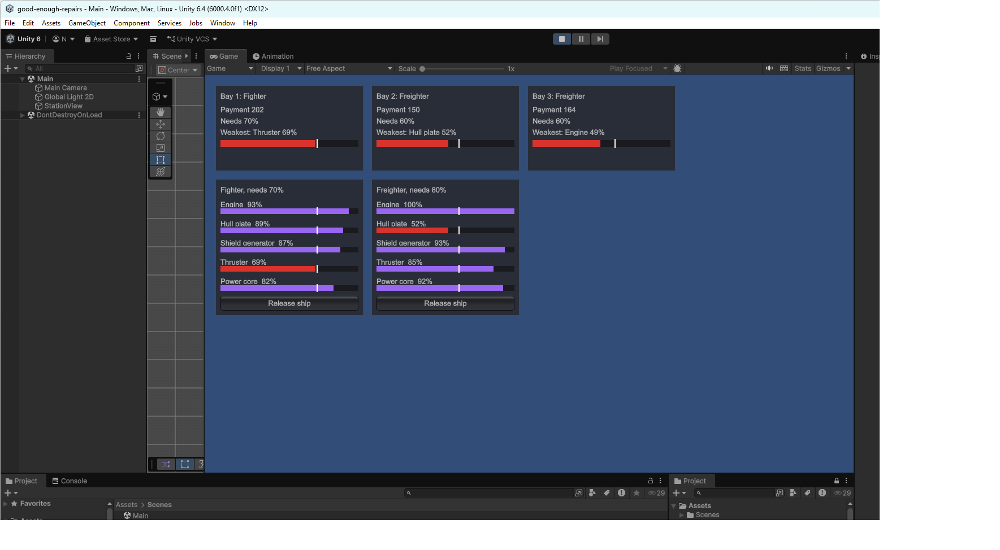

# Good Enough Repairs

A 2D management / repair puzzle game made in **Unity 6 (URP 2D)**. You are the space mechanic who keeps fighters and freighters flying. Ships dock with weak parts, and the winning move is not to buy new parts but to **swap** them: a fighter's 65% engine fails the fighter's 70% level, yet it is good enough for a freighter. Survive 7 days without going bankrupt.

Game design: [the GDD](docs/Good%20Enough%20Repairs%20-%20GDD.md). MVP cut order and checkpoints: [`docs/production-plan.md`](docs/production-plan.md).

This repository is the Unity project. The AI agents that help build it live next to the Unity folders in [`agents/`](agents/), outside `Assets/`, so Unity never imports them.

## The agent board

The agents' work is planned and tracked on a GitHub board, like Jira. The designer opens a **request** (issue template "Request to the Director"); the **Director** plans it as **epics** with one **task** per agent; the designer approves the tasks; the runner wakes each task's agent, runs the checks, has the task's reviewer approve or reject it, and moves the card. Agents talk through task comments. Each task shows **Attempt** (0/3 to 3/3) and **Used tokens**; after 3 rejections it goes to **Needs designer**. Each epic is one branch and one pull request the designer squash-merges. Full design: [`docs/agent-board-plan.md`](docs/agent-board-plan.md).

## How to run

Needs **Python 3.10+** (standard library only), the **Claude Code CLI** logged in (agents run through `claude -p` with your Claude login, no API key), and the **GitHub CLI** logged in: `winget install GitHub.cli`, then `gh auth login` and `gh auth refresh -s project`.

```bash
# from the project root
python agents/crew.py setup     # one time: labels, board, columns, fields
python agents/crew.py check     # is everything ready?
python agents/crew.py           # one pass: works until nothing is ready
python agents/crew.py --watch   # keeps running, checks the board every few minutes
python agents/crew.py --mock    # scripted demo: no GitHub, no Claude
python agents/crew.py todo 65   # the designer's card move: Backlog or Needs designer -> Todo
python agents/crew.py done 65   # accept a task waiting in Needs designer
```

Settings and toggles: [`agents/board/settings.json`](agents/board/settings.json) (`director_autoplan` and `autoapprove_tasks` off, `sound` on, by default). Close Unity while the runner works: it switches branches.

## Repository structure

```
Assets/                       Unity
Packages/  ProjectSettings/   Unity
.github/ISSUE_TEMPLATE/       request template for the Director
agents/
  crew.py                     agent board runner
  board/                      runner code, settings.json, roles/ (one prompt per agent)
docs/                         GDD, production plan, agent board plan
docs/crew/                    the crew's documents, e.g. the technical design (agents write, designer approves)
```

## Assignment 4: game content from the GDD

Request [#16](https://github.com/duke-nickam/good-enough-repairs/issues/16) asked the Director for three content outputs from the GDD. It planned epic [#35](https://github.com/duke-nickam/good-enough-repairs/issues/35), merged as PR [#41](https://github.com/duke-nickam/good-enough-repairs/pull/41). A polish request, [#42](https://github.com/duke-nickam/good-enough-repairs/issues/42), followed as epic [#43](https://github.com/duke-nickam/good-enough-repairs/issues/43), PR [#45](https://github.com/duke-nickam/good-enough-repairs/pull/45). Everything ran on the [agent board](https://github.com/users/duke-nickam/projects/1).

**What was generated**, in `Assets/StreamingAssets/content/`:

| File | Agent | Content |
|---|---|---|
| `mechanic_lines.json` | UX Designer (#37, #44) | 3 lines for each moment the GDD says the mechanic speaks (day start, release warning, penalty fill, end of day, bankruptcy, run end win and bankrupt), the GDD's exact tutorial hint, 3 fallback hints |
| `day_briefs.json` | UX Designer (#38, #44) | Days 1-7: the day type copied from `balance.json` and a two-sentence reason |
| `part_catalog.json` | UX Designer (#39) | Name and description for the GDD's five part types |

The epic also produced the content check `agents/checks/content.py` (QA Playtester, #36) and the loader in `Assets/Scripts/Content/` (Programmer, #40). The epic used about 136k tokens and the polish about 53k. Every task passed on attempt 1.

**Does it sound like the game?** Mostly yes. The lines are short, proud and cheeky, and they never give away the swap trick before the hint:

> "Every ship flying home on a patched part. Best feeling in the galaxy, and I earned it the hard way." (run end, win)
>
> "That spare on screen still has some life in it. Shame to waste it on the scrap heap." (fallback hint)
>
> "Patched, dented and still holding the air in, which is more than the factory ever promised for this one." (hull plate)

The day briefs were the weakest part: too long until the polish.

**What the critic caught.** Two critics run on every content task. The check script enforces the rules code can decide: valid JSON, no digits in text (economy numbers can change), no long dashes, LF line endings, exact keys, day types equal to `balance.json`. The Director reviews against the GDD:

- Fallback hints said the spare part is "in your inventory". The GDD only says "on screen", so it can be on a docked ship. Fixed in #44.
- A bankrupt ending mentioned "the next mechanic", but the player is the only mechanic. Fixed in #44.
- The day briefs had 3-4 sentences instead of 1-2, and day 3 didn't say why it's quiet. Fixed in #44.
- Left as they are: a day start line close to hinting the swap trick, the engine description, and day 7 saying time is "the only thing that matters" (money still decides bankruptcy).

**What the loop taught the system.** In the first plans, each content task's check read the whole content folder. Tasks then failed on their siblings' missing files and used up all 3 attempts. The fixes went into the runner, not the content:

- a plan rule: every check names its files, and a task depends on every task whose files it uses;
- an early stop when a check fails exactly like the try before;
- the Director asks instead of guessing what a file holds. That's how the part types got defined in GDD v1.4.

The request was planned again from scratch until the plan passed.

## Assignment 5: goal-oriented coding agent

The goal-oriented agent is the **Director** in goal mode, not a separate script: it already plans all work on the board, so it was taught to set and chase goals ([Goals](docs/agent-board-plan.md#goals)). A goal is a state the game should reach, with a "done when" the designer confirms. With `director_autoplan` on, the Director keeps a standing goal: every GDD feature in the current scope (the MVP) done.

| Assignment part | Where it lives |
|---|---|
| `priority_score()` | [`agents/board/priority.py`](agents/board/priority.py): +30 swap loop, +10 per gap that needs it, -20 to -5 by the production plan's cut order, 0 / -5 / -10 by size. The Director judges the factors; the function makes the order repeatable. The score is the epic's **Priority** field on the board, with its breakdown as a comment |
| Gap detection | The Director's goal step ([`agents/board/agents.py`](agents/board/agents.py) `GOAL_FORMAT`, [`runner.py`](agents/board/runner.py) `apply_gaps`). Like a lead before AI it scans the **board**, not the code: a GDD feature without a Done epic is a gap and gets an epic in Backlog. The programmers read the code their tasks list |
| Code-writing step | The top gap's epic gets tasks for the Programmer, QA Playtester and UX Designer. On a code task the Programmer first posts a **design note** for the designer; every C# task runs the Unity check [`agents/checks/editmode.py`](agents/checks/editmode.py) (Unity compiles the project and runs the EditMode tests in batch mode), and the agent fixes failures within its attempt |
| Iteration loop | When the epic is merged the runner reports it to the goal, the Director scans the board again, re-scores and plans the next gap. It stops when the goal is met, or asks the designer after 3 epics |

The game runs as code alone (GDD v1.5), so tests and bots play it without scenes. The crew's [technical design](docs/crew/technical-design.md) says how, written by the Programmer and approved by the designer.

### What the agent built

Epic [#55](https://github.com/duke-nickam/good-enough-repairs/issues/55) **Docking bays, ships and parts**, merged as PR [#69](https://github.com/duke-nickam/good-enough-repairs/pull/69):

- `Assets/Scripts/Logic/Parts/` and `Logic/Bays/`: part types and conditions, the required-level check, a seeded ship factory (weak parts from `balance.json`), 3 docking bays that refuse with a reason and raise events. Pure C#, no UnityEngine.
- 25 EditMode tests, green in Unity's batch run.
- `Assets/Scripts/UX/`: a placeholder display built in code, no prefabs. Press Play: ships dock into the bays; click a bay to see its five parts against the required level.



The fighter's thruster at 69% fails the fighter's 70%, yet a freighter would take it: the swap the game is about.

### Why the agent chose it

The standing goal [#54](https://github.com/duke-nickam/good-enough-repairs/issues/54) ranked 10 gaps. **#55 scored 70** (30 swap loop + 50, five gaps need it - 10 size L); all nine others waited for it. Before that, request [#46](https://github.com/duke-nickam/good-enough-repairs/issues/46) built the base: the technical design (#47) and the Unity test check (#48). Tokens: about 146k for #47, 111k for #48, 411k for #55.

### Manual changes before accepting

No game code was edited by hand. The designer:

- added the `StationView` component to `Main.unity` and committed the `.meta` files Unity made (agents never write Unity scene, prefab, asset or `.meta` files);
- corrected three task cards the Director planned from file names: #51 (folders from the design and a Logic assembly to test), #52 and #68 (missing reads);
- answered every design note and the design's open questions, e.g. replacing a deprecated test assembly setup (#51);
- reopened #52 (two Cyrillic letters in a folder name) and #66 (see below).

### What the loop taught the system

- A self-check retry re-sent only the fixed file, and the runner committed only the last try: three files were never reviewed. The runner now keeps every file of an attempt.
- Code and data files must be plain ASCII, checked by the runner.
- The Director reads `docs/crew/`, sees each epic's goal, and requires the Unity check on every C# task.
- Every agent gets the project's Unity and package versions.
- Agents can delete files, so they can move them.

## Assignment 6: the style loop

A self-correcting loop, **Generator -> Evaluator -> Refiner**, that holds the mechanic's lines to the game's own style. Run: `python agents/style_loop.py <moment> [--seed <draft.json>]`.

| Assignment part | Where it lives |
|---|---|
| Style guide from the GDD | [`docs/style-guide.md`](docs/style-guide.md): 11 rules with weights, each quoting its source in the GDD or the Assignment 4 review, and the job of each moment the mechanic speaks. The loop reads its rule table directly, so the page and the loop never disagree |
| Generator | The crew's **UX Designer** (fast model), who writes the mechanic's lines on the board too |
| Evaluator | The **Director** (large model) scores the 7 reading rules; **code** measures the 4 others (digits, long dashes, length, count and generic sci-fi words), so no agent can argue past them. Every rule gets a score 0-10, a reason and the exact words that broke it; the total is out of 100 |
| Refiner | The **UX Designer on its large model**, the GDD's "large model if it makes too many mistakes". It changes only what scored low and says what it changed and why |
| No intervention | The loop runs until 90/100 with no rule below 6, or 5 rounds. Every round is logged in [`docs/assignment-6/`](docs/assignment-6/) |

**Why the rules are this game's.** The player is the only mechanic, proud and cheeky, underpaid and resourceful; the swap trick is never explained, only nudged; a fallback hint points at a spare "on screen", never "in your inventory"; the world is fighters, freighters, three bays and five named parts; the station is rugged but meticulously kept; no digits, because economy numbers can change. Each comes from the GDD or a fix the Director made in Assignment 4.

### The runs

| Run | Rounds | Score per round | Tokens |
|---|---|---|---|
| [Bad seed, release warning, first run](docs/assignment-6/release_warning-seed.md) | 5 | 30, 80.5, 86.5, 89, 89 (round limit) | 76k |
| [Bad seed, release warning, after the fix below](docs/assignment-6/release_warning-seed-run2.md) | 3 | 33, 88, **91** | 42k |
| [Buy warning, from scratch](docs/assignment-6/buy_warning.md) | 3 | 87, 88.5, **91** | 49k |
| [Run end (win), from scratch](docs/assignment-6/run_end_win.md) | 3 | 87.5, 90 (blocked: one rule at 4/10), **94** | 50k |

The **seed** is a deliberately bad draft ([`seed-release-warning.json`](docs/assignment-6/seed-release-warning.json)): "Captain, this freighter's hyperdrive is shot", a long dash, "250 credits", "take the 65% engine from the fighter", "our crew of mechanics" with "the boss", "gleaming new bays", and "Release it if you want, genius". Round 1 scored 33/100, with reasons such as:

- S1 1/10: "explicitly tells the player to move a part from one ship to another, and names the 65% level"
- V3 0/10: "invents a crew of mechanics and a boss, which breaks the only-mechanic rule"
- V1 3/10: "mean to the player ('genius', 'you'll pay through the nose')"

Three rounds later, with no one stepping in:

> "Release it if you like, it's your ship. I'll fit a stock part in the empty slot, but it'll cost you more than doing it yourself."

From scratch, the buy warning and the run end met the bar in three rounds:

> "Shop price on that one, and it hurts. I only sell new when the scrap pile has nothing left to give." (buy warning)
>
> "Every bay is empty and every ship flew home. Fighters took the glory, freighters took the praise, and I took the spanners and did the lot." (run end, win)

The bar is more than the total: the run end reached 90/100 in round 2, but one line broke the length rule (4/10), so the loop went on and shortened it.

### What the loop taught the system

The first seed run stalled at 89. From round 3 the lines followed every rule, but the Evaluator kept marking down "underpaid and resourceful" and "rugged, kept station" because two lines showed no station. It read those rules as quotas: every line must show the station. The Refiner obeyed and packed benches and patched panels into every line, until one broke the length rule. The fix went into the guide and the Evaluator, not the content: both rules now say they are limits (a line that does not show the station follows them), and the Evaluator never asks for more than a rule requires. The second run met the bar in 3 rounds with about half the tokens.

Author: Nikola Bulog - ELVTR AI Game Development course.
