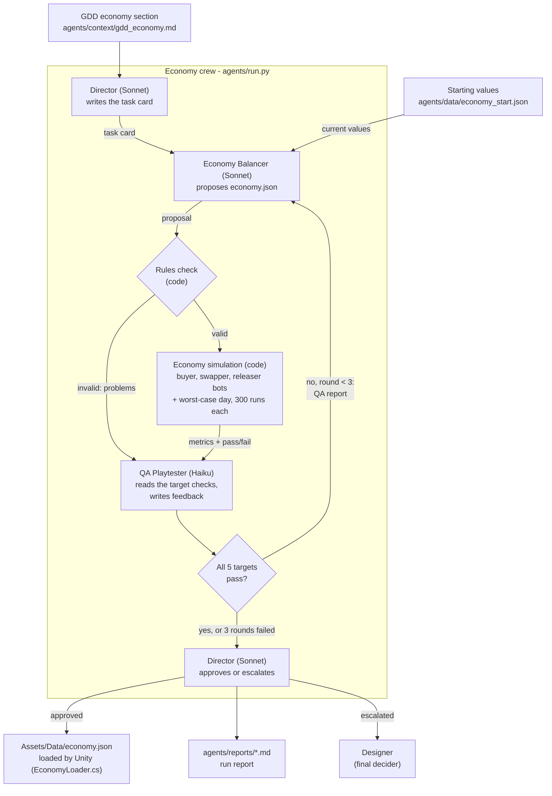

# Economy crew - agent roles and data flow

**Roles**

| Agent | Model | Reads | Produces (format) |
|---|---|---|---|
| Director | Claude Sonnet | GDD economy section, QA targets, tuning history | Task card and final decision (Markdown) |
| Economy Balancer | Claude Sonnet | Task card, current economy.json, last QA report | economy.json (JSON) |
| QA Playtester | Claude Haiku + simulation code | economy.json, simulation results, target checks | Verdict with feedback (JSON) |

The pass/fail checks are computed by the simulation, not by an agent, so the QA Playtester can explain results but cannot fake them.
