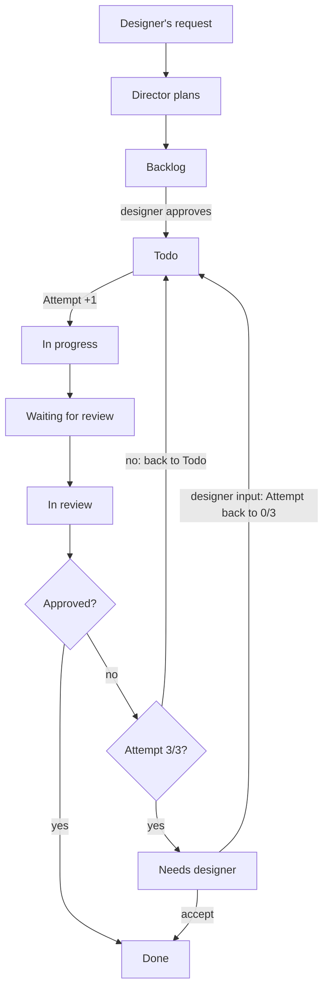

# Agent board - plan

Author: Nikola Bulog · Nov 8, 2026 (CET)

## Goal

The Director plans the work on a board, like Jira, and one general runner wakes the agents for it. Nothing is scripted per task or per kind of work: the board decides what happens next.

It is the GDD's own design: "the Director keeps a feature board, like Jira: one card per feature, with a subtask for each agent involved". The designer sees and controls all work on the board.

## The board

The board is GitHub Issues plus a GitHub Projects board in the game's repo: free, public, viewable in the browser and the GitHub phone app, and graders can open the links. Every item is a GitHub issue with its own number; its label says which kind it is.

| Kind | What it is | Who creates it | Moves through columns |
| --- | --- | --- | --- |
| Request | The designer's conversation with the Director: what is needed, the Director's questions, the answers | Designer, from the "Request to the Director" issue template (sets the `request` label) | No |
| Epic | A feature, like a Jira epic. Groups the tasks of all agents involved, with a progress bar | Director (through the runner) | Yes |
| Task | One agent's part of an epic, named for what that agent does, e.g. "Write mechanic lines" (UX Designer). A sub-issue of its epic | Director (through the runner) | Yes |

- An epic links to its request; the request gets a comment listing the epic and tasks it produced, and closes when its goal is met.
- Each task carries: the assigned agent, acceptance criteria, the files it may change, and the tasks it depends on.
- The board shows epics and tasks in columns. Requests stay off the board: the repo's issue list, filtered by the `request` label, lists them.
- Paperclip, a dedicated tool for running agent teams, is worth a look after the MVP.

## Statuses and fields

Seven columns; the runner moves the cards by fixed rules, except where the designer moves them.

| Column | Meaning |
| --- | --- |
| Backlog | Proposed by the Director, waiting for the designer's approval |
| Todo | Approved and ready for an agent; a rejected task comes back here |
| In progress | An agent is working on it |
| Waiting for review | The work is done; no reviewer has picked it up yet |
| In review | A reviewer is checking it |
| Done | Accepted |
| Needs designer | 3 attempts failed, or an agent asked a question only the designer can decide |

Two fields on every task, set by the runner:

| Field | Type | What it shows |
| --- | --- | --- |
| Used tokens | Number | All tokens the task used: every attempt, its reviews and code checks included. The epic shows the sum of its tasks plus the Director's planning. Never resets |
| Attempt | Single select: 0/3, 1/3, 2/3, 3/3 | Attempts started. A new task in Todo is 0/3; it goes up by one each time the card moves from Todo to In progress. Rejected on 3/3 → Needs designer |

- Tokens come from `claude -p`, which reports each call's input, output and cached tokens. The runner charges a review to the task under review.
- After each attempt the runner posts a comment, e.g. "Attempt 2: UX Designer 14k in / 1.2k out, review 31k in / 0.9k out. Task total: 92k."
- The runner compares real use with the GDD's token budget per agent and warns the designer when it is exceeded (the GDD's spending rule).
- Attempt and Used tokens together tell whether a task was big (one attempt, many tokens) or kept failing (many attempts).

One more field on epics planned for a goal: **Priority** (Number), the Director's priority score (see Goals). Higher goes first.

## Task flow

A rejected task goes back to Todo and the next attempt starts from there. On a rejection at 3/3 it goes to Needs designer, where the designer either sends it back with input (Attempt resets to 0/3) or accepts it. When all tasks of an epic are Done, the runner opens the pull request (see Branches).

## Designer control

Almost all control goes through GitHub: requests, talking to the Director, approving tasks (Backlog to Todo), escalated tasks, progress and costs. Outside it: starting the runner on the PC, the toggles in a settings file in the repo, the GDD in `docs/`, and accepting the work (pull requests, see Branches).

When a task lands in Needs designer, the designer reads its thread (each attempt, the reviewer's reasons, or the agent's question) and picks one action: a comment plus a card move.

| Action | Card goes to | Attempt |
| --- | --- | --- |
| Give direction: answer, decide, or sharpen the acceptance criteria | Todo | Resets to 0/3: new conditions, a fresh 3 attempts. The runner logs "Designer input: attempts reset (round 2)" |
| Accept it anyway (overrule the reviewer), with a reason | Done | Stays |
| Drop or replace it; a new split goes through a request to the Director | Closed | Stays |
| Do it yourself | Done | Stays |

The GDD is the designer's file; agents only read it.

- A rule change (a number, a mechanic, scope) gets a new version row (v1.4, date, what changed and why). A wording fix gets none.
- The decision comment names the version ("decided, GDD v1.4"), linking task, decision and GDD change.
- Agents always read the current file, so the next attempt uses the change.
- The Director can suggest the exact GDD wording in the thread; it never edits the file.

The crew's own documents, such as the Programmer's technical design, live in `docs/crew/`. Agents write them through tasks, and the designer approves them: a task that writes in `docs/crew/` goes to Needs designer after its review passes, and the designer moves it to Done or sends it back with input. The rest of `docs/` is the designer's.

## Runner

One general script, `agents/crew.py`, written once and never per task. It runs on the designer's PC, because it uses the designer's GitHub (`gh` CLI) and Claude logins. Each time it runs it:

1. Lets the Director read new requests and comments; the Director asks questions or proposes epics and tasks, which the runner creates in Backlog.
2. Picks a ready task (Todo, dependencies Done), moves it to In progress and raises Attempt.
3. Wakes the assigned agent with its role prompt, the task text and the files the task names.
4. Commits the agent's files, posts its result comment and moves the task to Waiting for review.
5. Wakes the reviewer, which approves or rejects in a comment; the runner moves the card by the rules.

| Mode | How it starts | When it stops |
| --- | --- | --- |
| Manual (default) | `python agents/crew.py` | When no task is ready or everything left needs the designer |
| Watch (optional) | `python agents/crew.py --watch` | Keeps running, checks the board every few minutes. A check is one small GitHub request and uses no tokens |

Two toggles in a settings file in the repo. On means "without the designer".

| Toggle | On | Off |
| --- | --- | --- |
| `director_autoplan` | The Director also has a standing goal: every GDD feature in the current scope done (see Goals) | The Director plans only from requests |
| `autoapprove_tasks` | New tasks skip Backlog and go to Todo; each starts as soon as its dependencies are Done | New tasks wait in Backlog for the designer |

Both toggles are Off by default. Every default in this system keeps the designer in control and uses fewer tokens; manual mode is the default for the same reason.

Stopping the runner is pausing it: all state is on the board. When it starts again, a task found In progress is retried in place with the same Attempt (no rejection happened), and a task found Waiting for review or In review gets its review.

A sound on the PC tells the designer when a task goes to Needs designer and when a run stops (`sound` in the settings, on by default).

## Goals

A goal is a state the game should reach, e.g. "every GDD feature is done", "the swap loop is playable" or "the game feels more relaxed". The Director is a goal-oriented agent: it works toward a goal in a loop until the goal is met.

- **Where goals come from:** the designer sets one in a request. With `director_autoplan` on, the Director also has a standing goal when no request gives one: every GDD feature in the current scope (`production-plan.md`) done. Like a lead before AI, it checks the board, not the code: a feature is done when its epic is Done (built, tested and merged).
- **Done when:** every goal has one, confirmed by the designer in the request thread before planning. A measurable goal is met when the board, the checks or the simulation say so; a taste goal ("funnier") is met when the designer says so, after a playtest.

The loop:

1. **Gaps:** what is still missing for the goal; each gap gets an epic in Backlog.
2. **Priority:** for each gap the Director judges whether it is part of the swap loop (`production-plan.md`, "Never cut"), its place in the cut order, its size, and which other gaps it needs. Its function `priority_score()` turns that into the epic's Priority:

   | Factor | Points |
   | --- | --- |
   | Part of the swap loop | +30 |
   | Each gap that needs this one | +10 |
   | Cut order 1 / 2 / 3 / 4 | -20 / -15 / -10 / -5 |
   | Size S / M / L | 0 / -5 / -10 |

   A gap that needs another gap gets no score yet: it cannot start. Ties go by GDD order. The Director posts the breakdown on the epic, e.g. "30 swap loop + 40 (4 gaps need it) = 70".
3. **Planning:** only the epic with the highest Priority gets tasks; one epic per goal is open at a time. The others stay in Backlog without tasks; an epic without tasks that leaves Backlog goes back. To set another order the designer opens a request, e.g. "Plan #52 next": requests come before the Director's own choice.
4. **Loop:** when the planned epic is Done, the next run checks the goal again, updates the Priorities and plans the next one. When the goal is met, the Director says so and its request closes: the merge is the designer's acceptance. If the designer commented after the epic was planned, the Director asks them to confirm and they close it. A designer's "not done" comment is a gap to plan, never overruled by a Done epic.
5. **Limit:** after 3 Done epics for one goal, the Director asks the designer before planning more: keep going, change the goal, or stop.

## Agents, reviewers and communication

Only the GDD's ten agents work on the board: Director, Programmer, Lead Programmer, Economy Balancer, UX Designer, Artist, Technical Artist, Sound Designer, QA Automation Engineer, QA Playtester. A new agent needs the designer's approval and a GDD update.

- **Human organization first:** roles, reviews and handoffs copy how a real studio works, before any AI-specific shortcut (designer decision, Nov 18, 2026 (CET)).
- **Roles:** each agent has one role prompt in `agents/board/roles/` and reads only what its task names, as the GDD's "How each agent works" table says.
- **Reviewer:** every task names its reviewer, chosen by the Director from the GDD's roles. As in a studio, code (C# or a check script) is reviewed by the Lead Programmer, and the Technical Artist's work by the UX Designer from screenshots; the plan check enforces both. Reviewers also see the task's Reads. Content tasks (text the player reads) are reviewed by the Director (designer decision, Nov 8, 2026 (CET); it may change if the Director stops doing work directly).
- **Code checks:** checks code can decide (the economy simulation's five targets, text rules such as length, placeholders and no economy numbers) run right after the agent writes its files. On a failure the agent gets the output and fixes its files within the same attempt, up to `check_retries` times (2 by default); the reviewer then sees the results. Their pass or fail is computed, so no agent can argue its way past them. A try that fails exactly like the try before ends the self-check, and an attempt that fails its checks exactly like the attempt before goes straight to Needs designer, without a review: the agent cannot fix it by itself. Likewise, a reviewer's rejection for the same main problem as the last rejection goes to Needs designer. Every result and review comment shows its tokens: input, cache write, cache read, output and turns. The game's EditMode tests are a check too, run in Unity's batch mode (close Unity while the runner works).
- **Design note first:** the Programmer's first try on a code task is a design note in the task thread, in game terms as for a project manager: what it builds, what it leaves out, decisions that change the game, files, questions. The Director reviews it like a producer: approve (back to Todo, Attempt 0/3, the code follows), revise (one round, `note_revise_rounds`), or ask the designer only what the GDD and `docs/crew/` leave open (Needs designer). `design_note_review` off sends every note to the designer. A note may name a file the card lacks; when the Director approves it and the plan rules allow it (no other open task writes it, code stays with the Programmer and the Lead Programmer's review), the runner adds it to the card's Files, otherwise the designer decides.
- **Questions go to the Director first:** when a task's agent stops with a question, the Director reads it like a producer: it answers what the GDD, `docs/crew/` or the card already answer (back to Todo), plans the one missing task another agent builds within the epic's goal, under the plan rules (the blocked task depends on it and starts again with fresh attempts), or leaves it to the designer. A missing piece only this epic needs becomes one more task in the epic; a general tool other epics will use, or anything bigger than one task, becomes its own tool request (`**Needed by:** #task`), done first, and the blocked task waits until it is closed. A tool may need a tool (`tool_depth`, default 2); deeper goes to the designer. A review blocked by work outside the task's files (`outside`) goes to the Director the same way instead of back to the agent; `crew.py triage N` sends a task already in Needs designer. `director_triage` off sends every question to the designer.
- **Workers see their screenshots:** a task whose checks make screenshots gets one look at them before the review (`self_look`, default on): it replies LOOKS RIGHT or sends corrected files. After a rejection, the next attempt gets the screenshots the reviewer judged.
- **Stay in the epic:** the runner takes the next ready task from the epic it is working in, and switches branches only when that epic has none. Before a task starts, its epic branch takes the newest main (a runner fix, a merged tool), as "Update from main" would; a conflict is undone and goes to the designer.
- **Scenes and prefabs:** the Technical Artist does not program: it writes specs (JSON), and the Programmer's builder tool (an editor tool, reviewed as code) turns them into prefabs and scenes. A check runs the tool in Unity, prints `MADE: <path>` for each file Unity made (the runner commits it with its .meta) and `SCREENSHOT: <absolute path>` for each image the reviewer opens.
- **Plan rule:** every check names the files it checks as arguments, and a check script checks only the files it is given. A task depends on every task that writes a file its checks or Reads use; a folder counts as every file in it. A plan that breaks this goes back to the Director: add the dependency, or narrow the check to the task's own files. The Director never assumes what a file holds: what the GDD leaves open, it asks the designer.
- **Communication:** agents never call each other. They talk through task comments: the agent posts its result, the reviewer posts approval or reasons to reject, and the next attempt reads the whole thread. The designer reads the same thread and answers in it.
- **Stop rule:** a task rejected on attempt 3/3 goes to Needs designer, matching the GDD's "after 3 failed tuning rounds, the designer decides".
- **Models:** the settings name a model per agent, from the GDD (large for the Director and Programmer, fast for the rest). The UX Designer and the Economy Balancer move to the large model on a retry, the GDD's "large model if it makes too many mistakes". The QA Playtester uses the large model: the fast one misread check results in reviews (designer decision, Nov 8, 2026 (CET)).

## Branches, commits and pull requests

One branch per epic and a pull request for the designer's acceptance, as the GDD says: "agents working on the same feature share one feature branch".

1. **Branch:** when an epic's first task starts, the runner creates `epic/<number>-<name>`, e.g. `epic/12-mechanic-lines`. `main` stays untouched.
2. **Commits:** each attempt's result is one commit, `#<task number> <task name> - <agent>, attempt <n>`, e.g. `#14 Write mechanic lines - UX Designer, attempt 1`. GitHub links `#14` to the task; the task comment links to the commit.
3. **Rejections:** the next attempt is another commit on the same branch, so every attempt stays in the history.
4. **Pull request:** when every task of the epic is Done, the runner opens a pull request from the epic branch to `main`.
5. **Acceptance:** the designer first switches to the epic branch and opens Unity, which imports and compiles the agents' files (check the Console), then commits the new .meta files to the branch and pushes. Then, back on main, the designer reviews and merges the pull request with **Squash and merge**: one commit on `main` per epic, the attempts stay visible in the pull request. The epic closes. Changes wanted → merge first, then a new request to the Director, which plans them as new work.

- The repo setting "Automatically delete head branches" keeps the branch list to active epics. Nothing is lost: the pull request keeps the commits, and GitHub's "Restore branch" brings a branch back.
- Text costs almost no space; Git compresses it and stores only changes.
- The runner pushes with the designer's existing Git login.

## Open decisions and later items

Open, for the designer: none right now.

Later, one line each:

- Large art and sound files: decide before the Artist and Sound Designer start (commit only accepted versions, or Git LFS).
- Event-driven watch mode through a GitHub Actions runner on the PC, instead of checking every few minutes.
- Look at Paperclip after the MVP.
- `agents/checks/simulate.py` repeats the game rules in Python: move the QA bots to the C# game once it runs as code alone.
