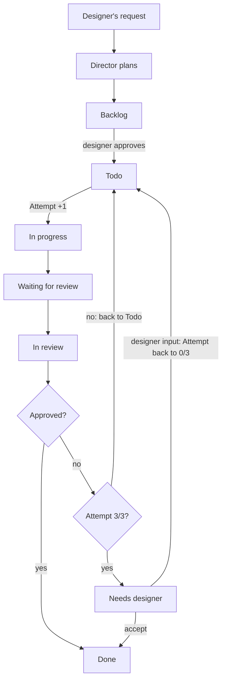

# Agent board - plan

Author: Nikola Bulog · Nov 8, 2026 (CET)

## Goal

The Director plans the work on a board, like Jira, and one general runner wakes the agents for it. Nothing is scripted per task or per kind of work: the board decides what happens next.

It is the GDD's own design: "the Director keeps a feature board, like Jira: one card per feature, with a subtask for each agent involved". The designer sees and controls all work on the board.

## The board

The board is GitHub Issues plus a GitHub Projects board in the game's repo: free, public, viewable in the browser and the GitHub phone app, and graders can open the links. Every item is a GitHub issue with its own number; its label says which kind it is.

| Kind | What it is | Who creates it | Moves through columns |
| --- | --- | --- | --- |
| Request | The designer's conversation with the Director: what is needed, the Director's questions, the answers | Designer, from the "Request to the Director" issue template (sets the `request` label) | No |
| Epic | A feature, like a Jira epic. Groups the tasks of all agents involved, with a progress bar | Director (through the runner) | Yes |
| Task | One agent's part of an epic, named for what that agent does, e.g. "Write mechanic lines" (UX Designer). A sub-issue of its epic | Director (through the runner) | Yes |

- An epic links to its request; the request gets a comment listing the epic and tasks it produced, and closes when its epic is done.
- Each task carries: the assigned agent, acceptance criteria, the files it may change, and the tasks it depends on.
- The board shows epics and tasks in columns. Requests stay off the board: the repo's issue list, filtered by the `request` label, lists them.
- Paperclip, a dedicated tool for running agent teams, is worth a look after the MVP.

## Statuses and fields

Seven columns; the runner moves the cards by fixed rules, except where the designer moves them.

| Column | Meaning |
| --- | --- |
| Backlog | Proposed by the Director, waiting for the designer's approval |
| Todo | Approved and ready for an agent; a rejected task comes back here |
| In progress | An agent is working on it |
| Waiting for review | The work is done; no reviewer has picked it up yet |
| In review | A reviewer is checking it |
| Done | Accepted |
| Needs designer | 3 attempts failed, or an agent asked a question only the designer can decide |

Two fields on every task, set by the runner:

| Field | Type | What it shows |
| --- | --- | --- |
| Used tokens | Number | All tokens the task used: every attempt, its reviews and code checks included. The epic shows the sum of its tasks plus the Director's planning. Never resets |
| Attempt | Single select: 0/3, 1/3, 2/3, 3/3 | Attempts started. A new task in Todo is 0/3; it goes up by one each time the card moves from Todo to In progress. Rejected on 3/3 → Needs designer |

- Tokens come from `claude -p`, which reports each call's input, output and cached tokens. The runner charges a review to the task under review.
- After each attempt the runner posts a comment, e.g. "Attempt 2: UX Designer 14k in / 1.2k out, review 31k in / 0.9k out. Task total: 92k."
- The runner compares real use with the GDD's token budget per agent and warns the designer when it is exceeded (the GDD's spending rule).
- Attempt and Used tokens together tell whether a task was big (one attempt, many tokens) or kept failing (many attempts).

## Task flow

A rejected task goes back to Todo and the next attempt starts from there. On a rejection at 3/3 it goes to Needs designer, where the designer either sends it back with input (Attempt resets to 0/3) or accepts it. When all tasks of an epic are Done, the runner opens the pull request (see Branches).

## Designer control

Almost all control goes through GitHub: requests, talking to the Director, approving tasks (Backlog to Todo), escalated tasks, progress and costs. Outside it: starting the runner on the PC, the toggles in a settings file in the repo, the GDD in `docs/`, and accepting the work (pull requests, see Branches).

When a task lands in Needs designer, the designer reads its thread (each attempt, the reviewer's reasons, or the agent's question) and picks one action: a comment plus a card move.

| Action | Card goes to | Attempt |
| --- | --- | --- |
| Give direction: answer, decide, or sharpen the acceptance criteria | Todo | Resets to 0/3: new conditions, a fresh 3 attempts. The runner logs "Designer input: attempts reset (round 2)" |
| Accept it anyway (overrule the reviewer), with a reason | Done | Stays |
| Drop or replace it; a new split goes through a request to the Director | Closed | Stays |
| Do it yourself | Done | Stays |

The GDD is the designer's file; agents only read it.

- A rule change (a number, a mechanic, scope) gets a new version row (v1.4, date, what changed and why). A wording fix gets none.
- The decision comment names the version ("decided, GDD v1.4"), linking task, decision and GDD change.
- Agents always read the current file, so the next attempt uses the change.
- The Director can suggest the exact GDD wording in the thread; it never edits the file.

## Runner

One general script, `agents/crew.py`, written once and never per task. It runs on the designer's PC, because it uses the designer's GitHub (`gh` CLI) and Claude logins. Each time it runs it:

1. Lets the Director read new requests and comments; the Director asks questions or proposes epics and tasks, which the runner creates in Backlog.
2. Picks a ready task (Todo, dependencies Done), moves it to In progress and raises Attempt.
3. Wakes the assigned agent with its role prompt, the task text and the files the task names.
4. Commits the agent's files, posts its result comment and moves the task to Waiting for review.
5. Wakes the reviewer, which approves or rejects in a comment; the runner moves the card by the rules.

| Mode | How it starts | When it stops |
| --- | --- | --- |
| Manual (default) | `python agents/crew.py` | When no task is ready or everything left needs the designer |
| Watch (optional) | `python agents/crew.py --watch` | Keeps running, checks the board every few minutes. A check is one small GitHub request and uses no tokens |

Two toggles in a settings file in the repo. On means "without the designer".

| Toggle | On | Off |
| --- | --- | --- |
| `director_autoplan` | The Director also proposes work on its own from the GDD and the board | The Director plans only from requests |
| `autoapprove_tasks` | New tasks skip Backlog and go to Todo; each starts as soon as its dependencies are Done | New tasks wait in Backlog for the designer |

Both toggles are Off by default. Every default in this system keeps the designer in control and uses fewer tokens; manual mode is the default for the same reason.

Stopping the runner is pausing it: all state is on the board. When it starts again, a task found In progress is retried in place with the same Attempt (no rejection happened), and a task found Waiting for review or In review gets its review.

A sound on the PC tells the designer when a task goes to Needs designer and when a run stops (`sound` in the settings, on by default).

## Agents, reviewers and communication

Only the GDD's seven agents work on the board: Director, Programmer, Economy Balancer, UX Designer, Artist, Sound Designer, QA Playtester. A new agent needs the designer's approval and a GDD update.

- **Roles:** each agent has one role prompt in `agents/board/roles/` and reads only what its task names, as the GDD's "How each agent works" table says.
- **Reviewer:** every task names its reviewer, chosen by the Director from the GDD's roles. Which role reviews which kind of task is an open decision (below).
- **Code checks:** checks code can decide (the economy simulation's five targets, text rules such as length, placeholders and no economy numbers) run as tools inside a review. Their pass or fail is computed, so no agent can argue its way past them.
- **Communication:** agents never call each other. They talk through task comments: the agent posts its result, the reviewer posts approval or reasons to reject, and the next attempt reads the whole thread. The designer reads the same thread and answers in it.
- **Stop rule:** a task rejected on attempt 3/3 goes to Needs designer, matching the GDD's "after 3 failed tuning rounds, the designer decides".
- **Models:** the settings name a model per agent, from the GDD (large for the Director and Programmer, fast for the rest). The UX Designer moves to the large model on a retry, the GDD's "large model if it makes too many mistakes".

## Branches, commits and pull requests

One branch per epic and a pull request for the designer's acceptance, as the GDD says: "agents working on the same feature share one feature branch".

1. **Branch:** when an epic's first task starts, the runner creates `epic/<number>-<name>`, e.g. `epic/12-mechanic-lines`. `main` stays untouched.
2. **Commits:** each attempt's result is one commit, `#<task number> <task name> - <agent>, attempt <n>`, e.g. `#14 Write mechanic lines - UX Designer, attempt 1`. GitHub links `#14` to the task; the task comment links to the commit.
3. **Rejections:** the next attempt is another commit on the same branch, so every attempt stays in the history.
4. **Pull request:** when every task of the epic is Done, the runner opens a pull request from the epic branch to `main`.
5. **Acceptance:** the designer reviews and merges it with **Squash and merge**: one commit on `main` per epic, the attempts stay visible in the pull request. The epic closes. Changes wanted → a comment on the pull request, which goes back through the Director as new work.

- The repo setting "Automatically delete head branches" keeps the branch list to active epics. Nothing is lost: the pull request keeps the commits, and GitHub's "Restore branch" brings a branch back.
- Text costs almost no space; Git compresses it and stores only changes.
- The runner pushes with the designer's existing Git login.

## Open decisions and later items

Open, for the designer:

- [ ] Who reviews content tasks: the Director (reads the whole GDD, rejects out-of-scope work, no GDD change needed) or a new Content Critic agent (needs a GDD update)? Decided last, after the rest of this plan.

Later, one line each:

- Large art and sound files: decide before the Artist and Sound Designer start (commit only accepted versions, or Git LFS).
- Event-driven watch mode through a GitHub Actions runner on the PC, instead of checking every few minutes.
- Look at Paperclip after the MVP.
